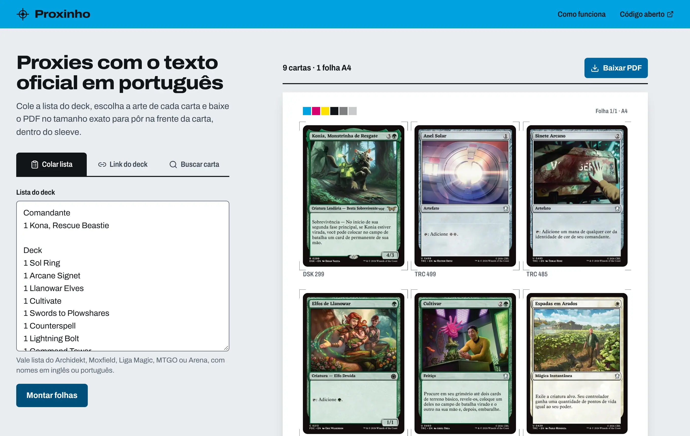
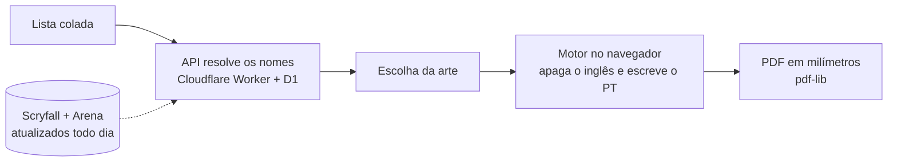

<div align="center">

# Proxinho

**Proxies com o texto oficial em português, em qualquer arte, prontos para imprimir.**

[proxinho.johnlaff.com](https://proxinho.johnlaff.com) · [Como funciona](#como-funciona) · [Arquitetura](docs/arquitetura.md) · [Decisões](docs/adr/README.md)

[](https://github.com/johnlaff/proxinho/actions/workflows/ci.yml)
[](https://github.com/johnlaff/proxinho/actions/workflows/dados.yml)
[](https://github.com/johnlaff/proxinho/actions/workflows/montagem.yml)
[](https://github.com/johnlaff/proxinho/actions/workflows/codeql.yml)



</div>

## O problema

A última coleção impressa em português saiu em junho de 2024. Desde então, cartas físicas só existem em inglês, num país onde cerca de 5% das pessoas falam a língua. O jogo digital continua traduzido, então muita gente aprende em português e, na mesa, recebe cartas que não consegue ler.

Quem quer jogar "em português" costuma imprimir um proxy (uma cópia de papel) e pôr na frente da carta original, dentro do sleeve. Só que as ferramentas de proxy dependem de já existir uma imagem em português da carta, e quase nunca existe na arte que a pessoa quer: das 38.832 imagens em português do Scryfall, só 4% estão em alta resolução.

## A solução

O Proxinho pega **qualquer impressão em inglês**, apaga o nome, o tipo e o texto e escreve no lugar o **texto oficial em português**, vindo do MTG Arena ou das impressões oficiais (as 87 que o Scryfall tem só na imagem foram transcritas dela; e, nas cartas que nunca saíram em PT, uma tradução não oficial, marcada como tal). A arte, a moldura, o custo de mana, o artista e o copyright continuam os da carta. No fim, entrega um PDF com as cartas no tamanho exato (63 × 88 mm), marcas de corte e uma régua para conferir a escala.

- 84,0% das cartas legais no Commander têm tradução oficial; entre as 1.000 mais jogadas, 98,4%. Com a tradução não oficial (ADR 0025), 99,8% saem em português: todas, fora as 48 folhas de adesivos de Unfinity, que não vão no deck (medido em 25/11/2026).
- Cola a lista de qualquer site (Archidekt, Moxfield, Liga Magic, MTGO, Arena), importa por link ou busca pelo nome em português. Nome com erro de digitação ganha um "Você quis dizer…?".
- O pedido fica guardado no navegador, com as artes escolhidas, e vai para um amigo num link, sem cadastro e sem nada guardado no servidor (ADR 0028).
- As cartas mais jogadas chegam prontas: o mesmo motor que roda no navegador monta tudo de antemão no servidor (ADR 0022), e o que ainda não está lá é montado no aparelho, na hora.
- Grátis, sem cadastro, sem anúncio.

<table>
<tr>
<td width="62%"></td>
<td></td>
</tr>
<tr>
<td>Cada carta mostra todas as artes e diz quais saem em português.</td>
<td>Funciona no celular.</td>
</tr>
</table>

## Como funciona



1. **Dados.** Todo dia, um script em Python cruza o banco de cartas do Scryfall com os textos em português do Arena e das impressões oficiais e carrega o resultado no Cloudflare D1 (33.830 cartas, 795 fichas e 89 emblemas, 104 mil impressões).
2. **Lista.** Um leitor único entende os formatos de exportação mais comuns, com seções (inclusive "Tokens"), coleção, número e nomes em português. O resumo do pedido sugere as fichas que as cartas do deck criam e nomes parecidos para os que não achou, e filtra a prova pelo resultado ("Em inglês…"). O pedido é guardado como lista, com as artes escolhidas, e vira link (`#pedido=…`).
3. **Carta.** No navegador, um canvas baixa o PNG oficial da impressão, apaga o texto em inglês reconstruindo a textura da moldura (máscara + preenchimento em pirâmide; nas caixas translúcidas dos planeswalkers e das artes sem borda, uma rede neural de inpainting, o LaMa, rodando no próprio navegador) e escreve o português com quebra de linha, símbolos de mana e corpo ajustado para caber.
4. **PDF.** As cartas são paginadas 3 × 3 em A4 ou Carta, com ou sem sangria, a 300 ou 480 dpi.

Detalhes em [docs/arquitetura.md](docs/arquitetura.md).

## Stack

| Camada | Tecnologia | Por quê |
|---|---|---|
| Interface | React 19, Vite 8, TypeScript 7 (strict) | Padrão de mercado, build rápido |
| Motor da carta | Canvas 2D, SVG de símbolos, Beleren, Matrix Bold, Goudy Medieval e MPlantin (com reserva OFL: Eczar, Splentinex) | O mesmo código no navegador e no montador em lote (Chromium com Playwright, em 12 máquinas do GitHub Actions), que deixa as cartas prontas no R2 |
| Inpainting | LaMa quantizado (37 MB, 30 MB compactado) com ONNX Runtime Web, numa worker: runtime WebGPU na placa de vídeo, runtime só de CPU sem ela | Apaga texto sobre arte sem deixar mancha; tudo no navegador |
| PDF | pdf-lib, carregado sob demanda | Medidas exatas em milímetros |
| API | Cloudflare Worker + D1 (SQLite) + R2 + Cache API | Um deploy só; as cartas prontas ficam abaixo de 6 GB, dentro da cota grátis do R2 |
| Dados | Python (só biblioteca padrão) no GitHub Actions | Atualização diária sem servidor |
| Qualidade | oxlint, oxfmt, Vitest, Playwright (desktop e celular) | Rápido e com poucos plugins |
| Esteira | GitHub Actions: CI, prévia por PR, deploy, dados diários, montagem das cartas, CodeQL, Dependabot | Actions fixadas por SHA, permissões mínimas; a montagem grava no R2 com o token OIDC do GitHub, sem senha guardada (ADR 0023) |

As escolhas e alternativas descartadas estão nos [registros de decisão](docs/adr/README.md).

## Rodando na sua máquina

Precisa de Node 24, pnpm 12 e Python 3.12+ (só para o pipeline completo).

```bash
git clone https://github.com/johnlaff/proxinho.git
cd proxinho
pnpm install
pnpm db:seed:local   # banco local com 14 cartas, uma ficha e um emblema de amostra
pnpm dev             # http://localhost:5173
```

Na primeira vez, o `pnpm dev` baixa o modelo de preenchimento dos planeswalkers e das artes sem borda (37 MB, conferido por SHA-256) e o grava compactado, com os dois runtimes do ONNX, em `public/modelos/`, fora do git. Sem rede, o site usa o preenchimento simples.

Para ter o banco completo localmente: `pnpm data:build` e depois `pnpm exec wrangler d1 execute proxinho --local --file data/out/cards.sql`.

| Comando | O que faz |
|---|---|
| `pnpm check` | Tipos, lint, formatação e testes de unidade |
| `pnpm test:e2e` | Testes de ponta a ponta no desktop e no celular |
| `pnpm test:coverage` | Cobertura dos testes de unidade |
| `pnpm test:data` | Testes de unidade do pipeline de dados (Python) |
| `pnpm regressao` | Regressão visual: monta ~630 cartas com o código desta árvore e com o da main e compara pixel a pixel (ADR 0027) |
| `pnpm build` | Build de produção |

## Como foi construído

O projeto foi feito por um agente de IA trabalhando de forma autônoma, seguindo o AI-DLC (AI-Driven Development Lifecycle): pesquisa e especificação antes do código, decisões registradas, testes como portão e o dono do produto decidindo o que é irreversível. O passo a passo está em [docs/aidlc.md](docs/aidlc.md).

- [Pesquisa: a dor, o estado da arte e o lado legal](docs/pesquisa.md)
- [Especificação e critérios de aceite](docs/specs/0001-gerador-de-proxies.md)
- [Guia de operação](docs/operacao.md)
- [Roadmap](docs/roadmap.md)
- [Guia para agentes de IA](AGENTS.md)

## Limites conhecidos

- A reescrita cobre a moldura moderna (2015+), a de 2003 a 2014, a antiga (1997 a 2003 e as reimpressões retrô) e a de 1993 (de Alpha a Alliances, de borda preta ou branca) de cartas normais (a de 2003 com as marcas-d'água das guildas e das facções, refeitas por baixo do português, e sem efeito de moldura, salvo o céu estrelado de Theros; a antiga e a de 1993 sem marca-d'água; as com Série, Spree, também), de duas faces (transformar e modais), de planeswalkers, de fichas (tokens, inclusive as de duas faces e as da moldura de 2003), de emblemas, de Sagas, de Aventuras, das cartas com Preparar, das cartas divididas (as Salas de Duskmourn, as da moldura atual, como Find // Finality e Fire // Ice, inclusive as com Fundir, como Wear // Tear, e as com Consequência, como Dusk // Dawn; as da moldura de 2003, de Dissension, Planar Chaos e Dragon's Maze, como Crime // Punishment e Turn // Burn; e as da moldura antiga, de Invasion e Apocalypse, como Life // Death e Wax // Wane), de Classes, das naves e planetas com "Posicionar", das criaturas com Mutação (Ikoria), das criaturas com Subir de Nível (Rise of the Eldrazi e as reimpressões, na moldura de 2003 e na atual), das Invocações de Final Fantasy (as criaturas Saga, de borda preta), da frente das cartas de fundir (meld: Bruna e Gisela, Urza, Mishra, Titânia), das cartas viradas de Kamigawa (flip, as duas metades, na moldura de 2003 e na atual), das criaturas com Protótipo (The Brothers' War e Modern Horizons 3) e as artes sem borda na moldura padrão (Secret Lair, Commander, Marvel e as variantes sem borda das coleções). Nas Sagas, cada capítulo fica ao lado do seu marcador, e os fios entre os capítulos mudam de lugar para o português caber; o lembrete do alto e a explicação das palavras-chave dos capítulos ("Arregimentar Orcs 1. (Coloque um marcador…)") saem em PT, com o texto oficial das cartas impressas, como na carta física. Nas Aventuras, a criatura vai na página da direita do livro e a aventura (nome, tipo e regras) na da esquerda; nas cartas com Preparar (Secrets of Strixhaven), o contrário: a criatura à esquerda do fio e a mágica preparada à direita. Nas Salas de Duskmourn, impressas deitadas, o nome e o texto de cada metade, a linha de tipo e o lembrete das Salas saem em PT (o lembrete, que nunca saiu impresso em PT, vem da explicação oficial que o Arena mostra ao lado da carta). Nas outras divididas da moldura atual cada metade sai como uma carta pequena, e nas com Consequência (Amonkhet) a metade de baixo, impressa de lado, também sai em PT; nas com Fundir, a faixa do pé sai com o lembrete oficial em PT ("Fundir (Você pode conjurar uma ou ambas as metades deste card da sua mão.)"). Nas divididas da moldura de 2003 o nome e o tipo saem na Matrix Bold, como nas cartas de pé dela, e nas da moldura antiga, em letras brancas com sombra, como nas cartas de pé dela, com o texto de cada metade alinhado como o inglês daquela metade. Nos planeswalkers, as faixas das habilidades mudam de lugar quando o texto em PT de uma cresce mais que o das outras, para a letra da caixa inteira caber maior, como nos impressos em PT. Nas Classes, as barras de nível mudam de lugar quando o texto em PT de um nível cresce mais que o dos outros, como na Classe impressa, e o lembrete do alto sai com o texto oficial ("(Ganhe o próximo nível como um feitiço…)"). Nas naves e planetas com "Posicionar", as faixas de cada nível, com o selo e a caixa de P/R, mudam de lugar para o texto em PT, como nas artes estendidas; a explicação do Posicionar, que nunca saiu impressa em PT, vem da explicação oficial que o Arena mostra ao lado da carta. Nas criaturas com Mutação, a linha da Mutação, com o lembrete, vai na faixa translúcida do alto da caixa, refeita pela rede neural por baixo das letras, e o resto no papel abaixo do fio, com a mesma letra, como na carta impressa em PT. Nas criaturas com Subir de Nível, o texto de cada faixa vai entre o selo e a caixa de P/R dela, com a mesma letra nas três, e os selos dizem "NÍVEL", como na carta impressa em PT. Nas Invocações de Final Fantasy, o lembrete vai na faixa larga do alto, os capítulos como nas Sagas e a palavra-chave da criatura, ou o flavor, na caixa abaixo da barra de tipo. Na frente das cartas de fundir, o P/R da carta fundida sai no pé da caixa, como o do verso nas de transformar, e o lembrete "(Funde-se com …)" das cartas impressas em PT, que o Arena não tem. Nas cartas viradas de Kamigawa, o tipo e o texto da metade de cima e os da de baixo, de cabeça para baixo, saem em PT (com a tradução não oficial: nenhuma saiu impressa em PT), e o nome fica em inglês. Nas criaturas com Protótipo, o lembrete vai na faixa colorida do alto da caixa, ao lado das abas do custo e do P/R do protótipo, que ficam, e o resto no papel, com a mesma letra, como na carta impressa em PT. Nas artes com nome de crossover (o Skeletor no Tinybones da Secret Lair), o nome do alto fica como impresso e o nome em PT vai na linha pequena logo abaixo. As Classes promocionais com o "&" de D&D em alto-relevo, as naves com "Posicionar" sem borda ou de vitrine, as Invocações de Final Fantasy sem borda (e os Knights of Round, cujo lembrete nunca saiu impresso em PT), as Aventuras de vitrine e de arte estendida, molduras especiais, promos de Game Day com a arte atrás da caixa e as de 2003 com o logotipo da promo como marca-d'água (FNM, Pro Tour, Junior) usam a imagem oficial em português quando existe; senão saem em inglês com aviso. Se o motor não reconhece a moldura de uma impressão (algumas edições especiais da Secret Lair têm o desenho invertido sem que os dados digam), a carta também sai em inglês, e a etiqueta muda para dizer isso.
- Na moldura antiga não há barra: o nome e o tipo são letras brancas com sombra sobre a moldura de mármore ou pedra. A rede neural refaz a moldura por baixo das letras em inglês (como nas artes sem borda) e o português sai em branco com a sombra, o nome na Goudy Medieval da época, com os acentos e a cedilha do português.
- Na moldura de 1993 também não há barra, mas as letras mudam com a coleção e a cor da carta: brancas com sombra nas molduras escuras de Revised em diante, "gravadas" (um miolo cinza com contorno escuro e brilho claro) de Alpha a Unlimited, nas Collectors' Editions e nas molduras claras. O motor mede o estilo, o tamanho e a linha das letras na imagem, inclusive nas digitalizações com a retícula da impressão, e o português sai no mesmo estilo; a caixa de papel claro (a renda das brancas, a névoa das douradas) também passa pela rede neural, que refaz a textura onde estava o inglês; os terrenos básicos ficam com a caixa vazia, como o texto oficial deles em PT.
- Nas modais, a faixa do pé com o resumo do outro lado também sai em português, como nas impressões em PT: "Terreno ⓣ: Adicione ⓡ.", "Clérigo", "Mágica Instantânea" (ADR 0029).
- O primeiro planeswalker ou arte sem borda da sessão baixa o modelo de preenchimento (37 MB com placa de vídeo, 33 MB sem, uma vez só, com o progresso na prévia). A carta aparece em português em poucos segundos, num rascunho, e o acabamento troca a imagem quando fica pronto, com a parte e o tempo que falta na tela. Com placa de vídeo, o acabamento leva segundos; sem, cada planeswalker leva cerca de 7 s e cada arte sem borda, cerca de 13 s num computador (num celular, mais). Se a rede neural travar ou falhar no navegador, o site tenta de novo de um jeito mais simples; se ainda assim não der, o planeswalker sai com o preenchimento simples e a arte sem borda sai na original, com aviso. A gaveta diz se a conta roda na placa de vídeo ou no processador (no Firefox do celular, que ainda não libera a placa de vídeo para sites, o Chrome costuma ser bem mais rápido). A arte padrão de cada carta continua sendo a com borda: a sem borda só sai se você escolher.
- Enquanto você revisa as folhas, o site já monta as cartas do PDF em segundo plano (com a economia de dados ligada no aparelho, só no clique), e as cartas prontas ficam guardadas no navegador: a mesma lista, aberta de novo, aparece acabada e o PDF sai na hora. Elas ocupam uns 20 MB por deck de 100 cartas; as mais antigas saem quando passa de 120 MB.
- Cartas sem texto oficial em PT saem com uma tradução não oficial (ADR 0025), marcada na folha, na gaveta e no resumo: cada linha que já saiu igual numa carta oficial vem igual (35% das linhas), a que só muda nos números segue o molde da oficial (4%) e o resto foi traduzido no padrão do Arena, com o glossário das cartas oficiais (62%). O nome fica em inglês, salvo quando existe o nome impresso em PT. Se falta a tradução de uma linha, a carta sai em inglês, como antes. O texto do Arena não traz a explicação das palavras-chave entre parênteses: ela vem das cartas impressas em PT, onde a carta física a tem, e, nas mecânicas que nunca saíram impressas em PT (Posicionar, Dobra Espacial, Cria, Preparar, Exaustão…), da explicação oficial que o Arena mostra ao lado da carta, quando ela diz o mesmo que a carta (4.416 faces com a explicação das cartas impressas e 692 cartas com a do Arena). Nas fichas, o texto vem do Arena: 534 de 795 têm português (cerca de 82% das fichas que as cartas de Commander criam). Nos emblemas, vem do texto oficial do planeswalker que o cria: 73 de 89.
- O texto usa as fontes das cartas reais (Beleren e MPlantin, a Matrix Bold no nome e no tipo da moldura de 2003 e a Goudy Medieval no nome da moldura antiga e da de 1993), servidas pelo Worker a partir do KV, fora deste repositório. Num clone sem esses arquivos, o site cai sozinho para fontes livres parecidas (Eczar e Splentinex). Também dá para escolher outros arquivos de fonte no site; eles ficam só no navegador.

## Aviso legal

O Proxinho é conteúdo de fã, gratuito e não oficial, permitido pela [Política de Conteúdo de Fãs](https://company.wizards.com/pt-br/legal/fancontentpolicy) da Wizards. Não é aprovado nem endossado pela Wizards. Partes dos materiais usados são propriedade da Wizards of the Coast. ©Wizards of the Coast LLC. Proxies são para uso pessoal; não venda.

Imagens das cartas: [Scryfall](https://scryfall.com). Textos do Arena: arquivos públicos da [Untapped.gg](https://untapped.gg); a explicação das palavras-chave nunca impressas em PT, das dicas do Arena instalado do dono do projeto. Preenchimento das caixas dos planeswalkers e das artes sem borda: [LaMa](https://github.com/advimman/lama) (Apache 2.0), na versão quantizada [lama-int4-int8](https://huggingface.co/othytenk/lama-int4-int8), rodando com o [ONNX Runtime Web](https://onnxruntime.ai) (MIT).

## Licença

Código sob a [licença MIT](LICENSE). Fontes livres de reserva sob a SIL Open Font License (ver `public/fonts/cartas/`); a Beleren, a Matrix Bold, a Goudy Medieval (MagicMedieval, grátis para uso não comercial, com as letras acentuadas montadas por `scripts/acentuar-medieval.py`) e a MPlantin não fazem parte do repositório. Símbolos de mana: ver `public/symbols/`.

Feito por [@johnlaff](https://github.com/johnlaff).
