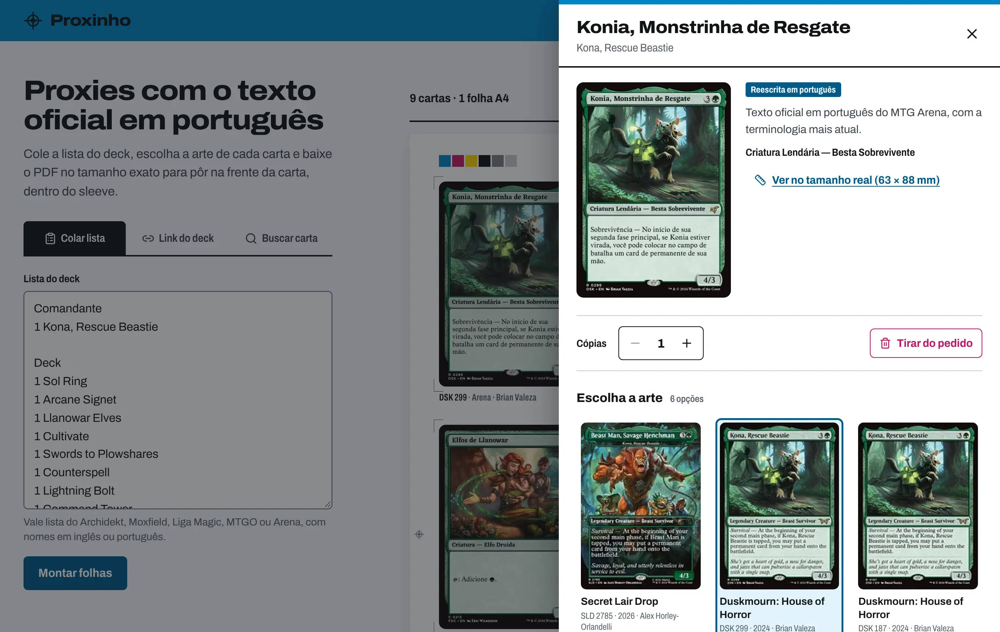
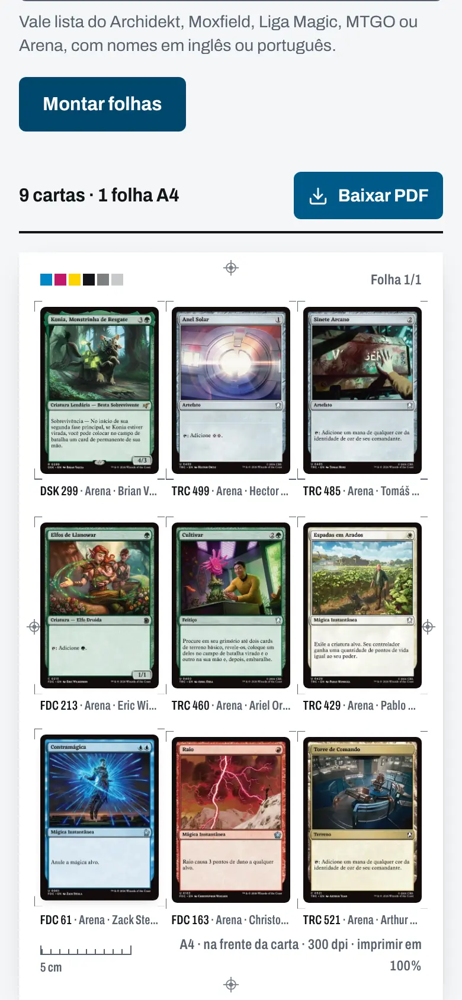
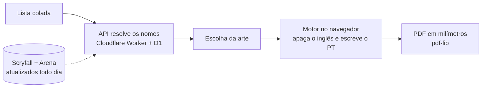

<div align="center">

# Proxinho

**Proxies com o texto oficial em português, em qualquer arte, prontos para imprimir.**

[proxinho.johnlaff.com](https://proxinho.johnlaff.com) · [Como funciona](#como-funciona) · [Arquitetura](docs/arquitetura.md) · [Decisões](docs/adr/README.md)

[](https://github.com/johnlaff/proxinho/actions/workflows/ci.yml)
[](https://github.com/johnlaff/proxinho/actions/workflows/dados.yml)
[](https://github.com/johnlaff/proxinho/actions/workflows/codeql.yml)


</div>

## O problema

A última coleção impressa em português saiu em junho de 2024. Desde então, cartas físicas só existem em inglês, num país onde cerca de 5% das pessoas falam a língua. O jogo digital continua traduzido, então muita gente aprende em português e, na mesa, recebe cartas que não consegue ler.

Quem quer jogar "em português" costuma imprimir um proxy (uma cópia de papel) e pôr na frente da carta original, dentro do sleeve. Só que as ferramentas de proxy dependem de já existir uma imagem em português da carta, e quase nunca existe na arte que a pessoa quer: das 38.832 imagens em português do Scryfall, só 4% estão em alta resolução.

## A solução

O Proxinho pega **qualquer impressão em inglês**, apaga o nome, o tipo e o texto e escreve no lugar o **texto oficial em português**, vindo do MTG Arena ou das impressões oficiais. A arte, a moldura, o custo de mana, o artista e o copyright continuam os da carta. No fim, entrega um PDF com as cartas no tamanho exato (63 × 88 mm), marcas de corte e uma régua para conferir a escala.

- 92,4% das cartas legais no Commander têm tradução oficial; entre as 1.000 mais jogadas, 98,9%.
- Cola a lista de qualquer site (Archidekt, Moxfield, Liga Magic, MTGO, Arena), importa por link ou busca pelo nome em português.
- Tudo é montado no navegador: o servidor não guarda nem distribui imagens.
- Grátis, sem cadastro, sem anúncio.

<table>
<tr>
<td width="62%"></td>
<td></td>
</tr>
<tr>
<td>Cada carta mostra todas as artes e diz quais saem em português.</td>
<td>Funciona no celular.</td>
</tr>
</table>

## Como funciona



1. **Dados.** Todo dia, um script em Python cruza o banco de cartas do Scryfall com os textos em português do Arena e das impressões oficiais e carrega o resultado no Cloudflare D1 (33.830 cartas, 795 fichas e 89 emblemas, 104 mil impressões).
2. **Lista.** Um leitor único entende os formatos de exportação mais comuns, com seções (inclusive "Tokens"), coleção, número e nomes em português. O resumo do pedido sugere as fichas que as cartas do deck criam.
3. **Carta.** No navegador, um canvas baixa o PNG oficial da impressão, apaga o texto em inglês reconstruindo a textura da moldura (máscara + preenchimento em pirâmide; nas caixas translúcidas dos planeswalkers e das artes sem borda, uma rede neural de inpainting, o LaMa, rodando no próprio navegador) e escreve o português com quebra de linha, símbolos de mana e corpo ajustado para caber.
4. **PDF.** As cartas são paginadas 3 × 3 em A4 ou Carta, com ou sem sangria, a 300 ou 480 dpi.

Detalhes em [docs/arquitetura.md](docs/arquitetura.md).

## Stack

| Camada | Tecnologia | Por quê |
|---|---|---|
| Interface | React 19, Vite 8, TypeScript 7 (strict) | Padrão de mercado, build rápido |
| Motor da carta | Canvas 2D, SVG de símbolos, Beleren e MPlantin (com reserva OFL: Eczar, Splentinex) | Roda no navegador, sem servidor de imagem |
| Inpainting | LaMa quantizado (37 MB) com ONNX Runtime Web, numa worker, WebGPU ou WebAssembly | Apaga texto sobre arte sem deixar mancha; tudo no navegador |
| PDF | pdf-lib, carregado sob demanda | Medidas exatas em milímetros |
| API | Cloudflare Worker + D1 (SQLite) + Cache API | Um deploy só, custo zero no plano atual |
| Dados | Python (só biblioteca padrão) no GitHub Actions | Atualização diária sem servidor |
| Qualidade | oxlint, oxfmt, Vitest, Playwright (desktop e celular) | Rápido e com poucos plugins |
| Esteira | GitHub Actions: CI, prévia por PR, deploy, dados diários, CodeQL, Dependabot | Actions fixadas por SHA, permissões mínimas |

As escolhas e alternativas descartadas estão nos [registros de decisão](docs/adr/README.md).

## Rodando na sua máquina

Precisa de Node 24, pnpm 12 e Python 3.12+ (só para o pipeline completo).

```bash
git clone https://github.com/johnlaff/proxinho.git
cd proxinho
pnpm install
pnpm db:seed:local   # banco local com 14 cartas, uma ficha e um emblema de amostra
pnpm dev             # http://localhost:5173
```

Na primeira vez, o `pnpm dev` baixa o modelo de preenchimento dos planeswalkers e das artes sem borda (37 MB, conferido por SHA-256) para `public/modelos/`, fora do git. Sem rede, o site usa o preenchimento simples.

Para ter o banco completo localmente: `pnpm data:build` e depois `pnpm exec wrangler d1 execute proxinho --local --file data/out/cards.sql`.

| Comando | O que faz |
|---|---|
| `pnpm check` | Tipos, lint, formatação e testes de unidade |
| `pnpm test:e2e` | Testes de ponta a ponta no desktop e no celular |
| `pnpm test:coverage` | Cobertura dos testes de unidade |
| `pnpm test:data` | Testes de unidade do pipeline de dados (Python) |
| `pnpm build` | Build de produção |

## Como foi construído

O projeto foi feito por um agente de IA trabalhando de forma autônoma, seguindo o AI-DLC (AI-Driven Development Lifecycle): pesquisa e especificação antes do código, decisões registradas, testes como portão e o dono do produto decidindo o que é irreversível. O passo a passo está em [docs/aidlc.md](docs/aidlc.md).

- [Pesquisa: a dor, o estado da arte e o lado legal](docs/pesquisa.md)
- [Especificação e critérios de aceite](docs/specs/0001-gerador-de-proxies.md)
- [Guia de operação](docs/operacao.md)
- [Roadmap](docs/roadmap.md)
- [Guia para agentes de IA](AGENTS.md)

## Limites conhecidos

- A reescrita cobre a moldura moderna (2015+) de cartas normais, de duas faces (transformar e modais), de planeswalkers, de fichas (tokens, inclusive as de duas faces e as da moldura de 2003), de emblemas e as artes sem borda na moldura padrão (Secret Lair, Commander, Marvel e as variantes sem borda das coleções). Nas artes com nome de crossover (o Skeletor no Tinybones da Secret Lair), o nome do alto fica como impresso e o nome em PT vai na linha pequena logo abaixo. Sagas, aventuras, molduras especiais e promos de Game Day com a arte atrás da caixa usam a imagem oficial em português quando existe; senão saem em inglês com aviso. Se o motor não reconhece a moldura de uma impressão (algumas edições especiais da Secret Lair têm o desenho invertido sem que os dados digam), a carta também sai em inglês, e a etiqueta muda para dizer isso.
- Nas modais, a faixa do pé com o resumo do outro lado continua em inglês.
- O primeiro planeswalker ou arte sem borda da sessão baixa o modelo de preenchimento (~66 MB, uma vez só, com o progresso na prévia); sem placa de vídeo, cada planeswalker leva cerca de 6 s e cada arte sem borda, cerca de 18 s (num celular, mais). Se a rede neural travar ou falhar no navegador, o site tenta de novo de um jeito mais simples; se ainda assim não der, o planeswalker sai com o preenchimento simples e a arte sem borda sai na original, com aviso. A arte padrão de cada carta continua sendo a com borda: a sem borda só sai se você escolher.
- Cartas sem tradução oficial saem em inglês. Não usamos tradução automática. Nas fichas, o texto vem do Arena: 534 de 795 têm português (cerca de 82% das fichas que as cartas de Commander criam). Nos emblemas, vem do texto oficial do planeswalker que o cria: 73 de 89.
- O texto usa as fontes das cartas reais (Beleren e MPlantin), servidas pelo Worker a partir do KV, fora deste repositório. Num clone sem esses arquivos, o site cai sozinho para fontes livres parecidas (Eczar e Splentinex). Também dá para escolher outros arquivos de fonte no site; eles ficam só no navegador.

## Aviso legal

O Proxinho é conteúdo de fã, gratuito e não oficial, permitido pela [Política de Conteúdo de Fãs](https://company.wizards.com/pt-br/legal/fancontentpolicy) da Wizards. Não é aprovado nem endossado pela Wizards. Partes dos materiais usados são propriedade da Wizards of the Coast. ©Wizards of the Coast LLC. Proxies são para uso pessoal; não venda.

Imagens das cartas: [Scryfall](https://scryfall.com). Textos do Arena: arquivos públicos da [Untapped.gg](https://untapped.gg). Preenchimento das caixas dos planeswalkers e das artes sem borda: [LaMa](https://github.com/advimman/lama) (Apache 2.0), na versão quantizada [lama-int4-int8](https://huggingface.co/othytenk/lama-int4-int8), rodando com o [ONNX Runtime Web](https://onnxruntime.ai) (MIT).

## Licença

Código sob a [licença MIT](LICENSE). Fontes livres de reserva sob a SIL Open Font License (ver `public/fonts/cartas/`); a Beleren e a MPlantin não fazem parte do repositório. Símbolos de mana: ver `public/symbols/`.

Feito por [@johnlaff](https://github.com/johnlaff).
