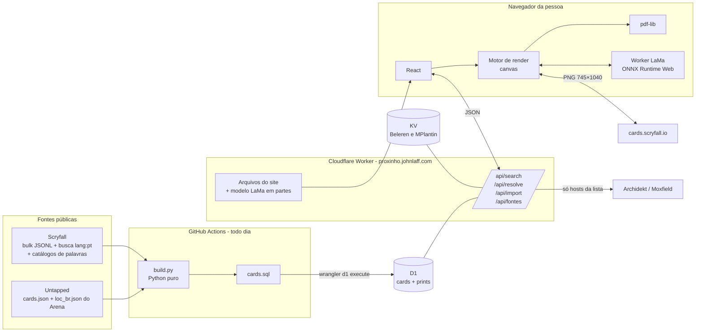

# Arquitetura

O Proxinho tem três partes: um **pipeline de dados** que roda uma vez por dia, uma **API** pequena no Cloudflare e o **site**, onde acontece o trabalho pesado (montar cada carta e o PDF).

## Caminho de uma lista

1. **Colar.** `src/lib/decklist.ts` lê a lista (MTGO, Arena, Moxfield, Archidekt, Liga Magic), entende seções (comandante, deck, sideboard e fichas), coleção, número e foil, e junta linhas repetidas.
2. **Resolver.** `POST /api/resolve` recebe até 250 nomes, casa cada um com o nome em inglês, o da frente de cartas de duas faces ou o nome em português (sem acento e sem maiúsculas) e devolve a carta com o texto PT e até 80 impressões. Fichas ficam por último, salvo nas linhas da seção "Tokens", que as preferem.
   - **Fichas do deck.** Cada carta traz `tokens` (os `oracle_id` das fichas que cria). O site junta as do pedido, busca as que faltam em `POST /api/cards` e as oferece no resumo; a busca também acha fichas e as adiciona pelo `oracle_id`.
3. **Escolher a arte.** `src/app/model.ts` escolhe a impressão inicial: a pedida na lista, senão a mais recente com moldura suportada, em alta, com borda (a arte sem borda só se a pessoa escolher), sem promo. Sem moldura suportada, a imagem oficial em PT; sem ela, a original em inglês com aviso.
4. **Prévia.** `src/app/preview.ts` monta cada carta com a imagem leve do Scryfall (488 × 680), 4 por vez, com cache. Planeswalkers e artes sem borda usam o PNG já na prévia (ver abaixo). Cartas de duas faces ocupam dois espaços na folha: frente e verso. Quando o motor não reconhece a moldura na imagem e devolve a original (raro: o Garruk espelhado da Secret Lair tem os dados de uma moldura comum), a prévia anota a falha (`noteRender`) e as etiquetas e o resumo passam a dizer que a carta sai em inglês.
5. **PDF.** `src/app/exportPdf.ts` monta de novo com o PNG (745 × 1040, 300 ou 480 dpi), 2 por vez, e `src/lib/pdf.ts` pagina em 3 × 3, com frente e verso seguidos em cada cópia de carta de duas faces. A sangria tem a cor da borda da carta; nas artes sem borda, é a própria imagem esticada até a beira da célula (`bleedLayers`).

## O motor da carta

`src/engine/render.ts` faz quatro passos num canvas:

1. Baixa a imagem do CDN do Scryfall (CORS liberado, então o canvas pode ser lido).
2. **Apaga** nome, tipo e caixa de texto (`erase.ts`): uma máscara marca os pixels de texto (escuros ou de cor diferente da textura; em faixas escuras, o contrário), cresce um pouco para pegar a borda suavizada e é preenchida de fora para dentro numa pirâmide de resoluções, o que reconstrói a cor da moldura; o grão do papel vem por cima, copiado em remendos de outros pontos da mesma região (`addGrain`), de perto e, no meio de um texto denso, de qualquer ponto dela. Num papel de retícula grossa a pirâmide parte da média dos vizinhos, não do pixel exato (`smoothNoisyPaper`). Caixa de texto escura ou barra de tipo sem os dois fios não é a moldura da M15 e a carta sai na original (`notM15Frame`). Nas cartas com tabela de d20 (AFR, AFC, CLB) as faixas cinza atrás das linhas da tabela saem inteiras (`liftShadedBands`) e são pintadas de novo atrás das linhas da tabela em português (`drawTableBands`). Abaixo da medida fixa da caixa só sai o que se liga às letras de cima, nunca o fio de baixo (`keepAttachedBelow`); o lembrete "3/5" do verso das cartas de transformar é apagado até a moldura, linha a linha (`eraseBackPtNotch`); e nas fichas o fio entre as regras e o flavor sai inteiro (`dividerRows`). Poder/resistência, custo de mana e símbolo da coleção ficam protegidos.
   - Nos **planeswalkers** (`planeswalker.ts`) a moldura (caixa alta ou normal) e as faixas de cada habilidade são medidas na própria imagem (o texto de cada habilidade fica centrado no escudo dela, e a última faixa apaga até o fio de baixo da caixa), e a caixa translúcida é preenchida por uma rede neural de inpainting, o **LaMa** (`lama.ts`), numa worker separada (`lamaWorker.ts`): na placa de vídeo (WebGPU) quando há, na CPU (WebAssembly) quando não. A pirâmide deixaria uma mancha borrada sobre a arte; o LaMa continua a textura. A caixa da lealdade inicial vai escondida do modelo, para a cor preta dela não vazar no papel acima (ADR 0011), e os pingos de tinta que o modelo às vezes inventa no papel liso saem depois do preenchimento (`dropSpecks`). Detalhes no ADR 0008.
   - Nas **artes sem borda** (`borderless.ts`) a arte ocupa a carta inteira e nome, tipo e regras ficam em barras e numa caixa translúcidas, escuras, com letra branca, nos lugares da M15. O motor confere a moldura na imagem (o aro dos dois lados da caixa e a barra do nome no alto, `borderlessBox`) e desiste, com a carta na original, quando ela não bate, quando a caixa, ou uma parte grande dela, é clara (`lightBorderlessBox`) ou quando a arte atrás tem retícula grossa (`screenNoise`). A máscara marca só as letras brancas (`whiteTextMask`) e o fio entre as regras e o flavor (`boxDividers`), e tudo vai ao LaMa: a caixa em dois quadros de 512 px na resolução da própria imagem (`nativeTiles`), com a cor inventada sem nada parecido em volta devolvida à média da vizinhança (`tameInvented`) e o grão da vizinhança de volta depois (`regrain`, nunca mais forte que o grão fino em volta de cada ponto); as duas barras num quadro só. O selo de promoção fica escondido do modelo (`borderlessStamp`: o que destoa do fundo, não é liso e tem par da mesma cor do outro lado do eixo dele, dentro do retângulo de `findCardStamp`, que procura a borda preta e, sem ela, o pé medido da caixa). A caixa de P/R é medida contra a arte das mesmas linhas, com o desenho da moldura de reserva (`borderlessPtBox`): a medida das molduras opacas compara com o papel acima da caixa de texto, que aqui é a arte. Nas cartas com nome de crossover (`flavor_name`, como o Skeletor no Tinybones da Secret Lair) o nome do alto fica como impresso e o nome em PT vai na aba logo abaixo da barra, no lugar do nome de jogo em inglês (`subtitleLetters`, com a aba achada pelo aro de baixo, `subtitleShift`); a aba vai sozinha ao LaMa, também nas artes com borda. Detalhes no ADR 0012.
   - Nas **fichas** (`token.ts`) a linha de tipo muda de altura conforme o texto: o motor acha a barra pelos dois fios escuros que a emolduram e o pé da caixa pelo fio de baixo. O nome em inglês é apagado só entre a primeira e a última letra (`centralSpan`, que ignora o brilho e o contorno claros das pontas da barra); o português sai centralizado em versalete, e texto de uma linha só, centralizado (ADR 0009). Emblemas usam a mesma moldura; o título é o nome do planeswalker ou a palavra "Emblema", conforme a largura do título impresso, e o texto sai centrado quando o inglês é centrado (ADR 0010). Neles e nas fichas sem P/R o canto da caixa de P/R também é apagado. Na moldura de 2003, a placa escura do nome é achada pela cor de fundo e pelo filete dourado em volta dela, repintada e recebe o nome em dourado (ADRs 0010 e 0011); nas outras, o nome sai em branco ou preto, ou no dourado medido das letras apagadas (ADR 0011).
   - Nas **cartas de duas faces**, o motor desvia dos ícones de transformar, do indicador de cor e do lembrete de P/R do verso (ADR 0007). As **Lições** (STX, TLA, SOS) têm o mesmo círculo à esquerda do nome, e o nome começa depois dele (`hasLeftIcon`; nas de SOS, sem o efeito marcado no Scryfall, o ícone é conferido na imagem por `hasLessonIcon`, ADR 0011).
   - **Medidas na imagem.** A moldura real muda alguns pixels entre coleções e digitalizações, então o motor confere na própria imagem os fios da caixa de texto (`insideBoxSides`), a barra de tipo mais baixa da arte estendida (`typeBarTop`), o topo e o lado da caixa de P/R (`ptBoxTop`, `ptBoxLeft`), o selo de promoção (`findStamp`, com a proteção seguindo a curva da cúpula dele, `stampShape`), onde começa o símbolo da coleção (`findSetSymbolLeft`; linha a linha, quando ele avança na diagonal sobre o tipo, `symbolRowsLeft`), a cor das letras, fatia por fatia (`textPolarity`), e a ponta arredondada das barras, linha a linha (`barCapGuard`), que fica intacta e não semeia a máscara. Nas caixas de letra escura o limiar das letras é medido por ladrilho (`tileNoise`), para a textura de uma caixa translúcida metade sobre a arte não virar "texto". Nas barras, um trecho denso da máscara abaixo das letras é arte que invade a moldura e fica (`dropArtBelowText`). A medida fixa de `geometry.ts` é o ponto de partida e o limite. A caixa de P/R e o selo ficam e não servem de fonte para o preenchimento, para a cor deles não vazar no papel (ADR 0011).
3. **Amplia** para a resolução de impressão.
4. **Escreve** o português (`text.ts`) com a Beleren (nome e tipo) e a MPlantin (texto), servidas em `/api/fontes/` a partir do KV (`fonts.ts`; sem elas, Eczar e Splentinex): quebra em linhas com símbolos de mana em SVG (travessão e número no fim da habilidade nunca começam linha; a continuação de uma opção "•" recua até o texto dela), procura o maior corpo que cabe (de 34 a 15), põe lembretes em itálico e o texto de ambientação só se couber com folga. O texto sai alinhado à esquerda, ou centrado quando o inglês da própria imagem é centrado (alguns feitiços curtos, muitas fichas e emblemas), medido antes de apagar (`measureCentered`).

As medidas da moldura estão em `geometry.ts`, na escala da imagem de 745 × 1040.

## Banco (D1)

- `cards`: uma linha por carta (`oracle_id`), com nome em inglês e português, apelidos normalizados para busca (`search_en`, `search_pt`), origem do texto (`arena` ou `impresso`), faces em JSON, a impressão PT mais recente e `tokens` (JSON com as fichas que a carta cria). As fichas e os emblemas também são linhas de `cards`, com `layout = 'token'` e, nas faces, P/R e cores. Uma face pode ter `ability_words`: as linhas do texto em PT que começam com palavra de habilidade ou de ambientação ("Aterragem — …"), que o motor escreve em itálico, como na carta impressa; a lista dessas palavras vem dos catálogos do Scryfall (`/catalog/ability-words` e `/catalog/flavor-words`), e as palavras-chave com travessão ("Max speed —") ficam de fora. Cada face de uma ficha de duas faces é uma linha de `prints` da ficha equivalente; a de trás tem id `<id>#1` (`printImage` em `src/engine/types.ts`).
- `prints`: uma linha por impressão em inglês, com coleção, número, artista, data, moldura, efeitos, a coluna `supported` calculada pelo pipeline, `text_flavor` (o flavor em inglês dela é o mesmo da impressão de onde veio o texto em PT, `text_print`: o flavor em PT vale também para ela), `flavor_name` (o nome de crossover impresso no alto, quando há), `indicator` (indicador de cor numa carta de uma face só, como Crashing Footfalls) e, nas cartas de duas faces, `sides` (JSON com custo, P/R, indicador e suporte de cada face).
- `meta`: data da última atualização (aparece em `/api/health`).

## Segurança

- CSP restrita (`public/_headers`): scripts só do próprio site (mais `wasm-unsafe-eval` para o WebAssembly do LaMa), imagens só do Scryfall.
- Isolamento de origem (`Cross-Origin-Opener-Policy: same-origin` e `Cross-Origin-Embedder-Policy: credentialless`), que libera várias threads no WebAssembly.
- Importador com lista fechada de hosts, para o Worker não virar proxy aberto.
- Nenhum dado pessoal: sem cadastro, sem cookies; a lista fica só no `localStorage` do navegador.
