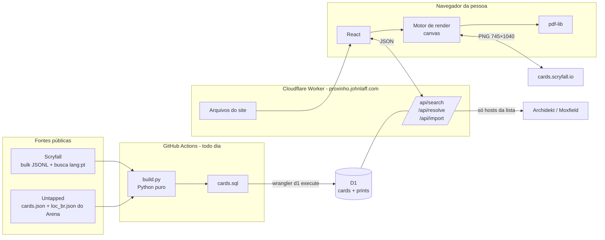

# Arquitetura

O Proxinho tem três partes: um **pipeline de dados** que roda uma vez por dia, uma **API** pequena no Cloudflare e o **site**, onde acontece o trabalho pesado (montar cada carta e o PDF).

## Caminho de uma lista

1. **Colar.** `src/lib/decklist.ts` lê a lista (MTGO, Arena, Moxfield, Archidekt, Liga Magic), entende seções, coleção, número e foil, e junta linhas repetidas.
2. **Resolver.** `POST /api/resolve` recebe até 250 nomes, casa cada um com o nome em inglês, o da frente de cartas de duas faces ou o nome em português (sem acento e sem maiúsculas) e devolve a carta com o texto PT e até 80 impressões.
3. **Escolher a arte.** `src/app/model.ts` escolhe a impressão inicial: a pedida na lista, senão a mais recente com moldura suportada, em alta, sem promo. Sem moldura suportada, a imagem oficial em PT; sem ela, a original em inglês com aviso.
4. **Prévia.** `src/app/preview.ts` monta cada carta com a imagem leve do Scryfall (488 × 680), 4 por vez, com cache.
5. **PDF.** `src/app/exportPdf.ts` monta de novo com o PNG (745 × 1040, 300 ou 480 dpi), 2 por vez, e `src/lib/pdf.ts` pagina em 3 × 3.

## O motor da carta

`src/engine/render.ts` faz quatro passos num canvas:

1. Baixa a imagem do CDN do Scryfall (CORS liberado, então o canvas pode ser lido).
2. **Apaga** nome, tipo e caixa de texto (`erase.ts`): uma máscara marca os pixels de texto (escuros ou de cor diferente da textura), cresce um pouco para pegar a borda suavizada e é preenchida de fora para dentro numa pirâmide de resoluções, o que reconstrói a textura da moldura. Poder/resistência, custo de mana e símbolo da coleção ficam protegidos.
3. **Amplia** para a resolução de impressão.
4. **Escreve** o português (`text.ts`): quebra em linhas com símbolos de mana em SVG, procura o maior corpo que cabe (de 34 a 15), põe lembretes em itálico e o texto de ambientação só se couber com folga.

As medidas da moldura estão em `geometry.ts`, na escala da imagem de 745 × 1040.

## Banco (D1)

- `cards`: uma linha por carta (`oracle_id`), com nome em inglês e português, apelidos normalizados para busca (`search_en`, `search_pt`), origem do texto (`arena` ou `impresso`), faces em JSON e a impressão PT mais recente.
- `prints`: uma linha por impressão em inglês, com coleção, número, artista, data, moldura, efeitos e a coluna `supported` calculada pelo pipeline.
- `meta`: data da última atualização (aparece em `/api/health`).

## Segurança

- CSP restrita (`public/_headers`): scripts só do próprio site, imagens só do Scryfall.
- Importador com lista fechada de hosts, para o Worker não virar proxy aberto.
- Nenhum dado pessoal: sem cadastro, sem cookies; a lista fica só no `localStorage` do navegador.
