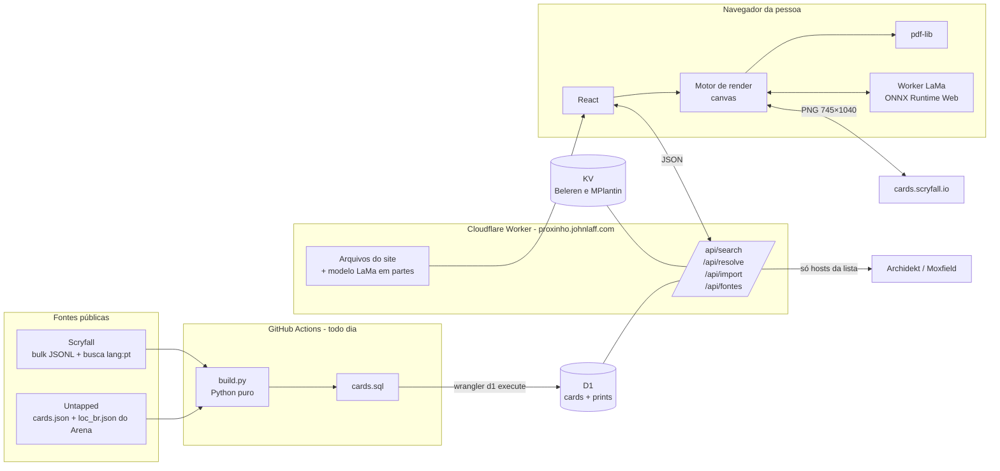

# Arquitetura

O Proxinho tem três partes: um **pipeline de dados** que roda uma vez por dia, uma **API** pequena no Cloudflare e o **site**, onde acontece o trabalho pesado (montar cada carta e o PDF).

## Caminho de uma lista

1. **Colar.** `src/lib/decklist.ts` lê a lista (MTGO, Arena, Moxfield, Archidekt, Liga Magic), entende seções (comandante, deck, sideboard e fichas), coleção, número e foil, e junta linhas repetidas.
2. **Resolver.** `POST /api/resolve` recebe até 250 nomes, casa cada um com o nome em inglês, o da frente de cartas de duas faces ou o nome em português (sem acento e sem maiúsculas) e devolve a carta com o texto PT e até 80 impressões. Fichas ficam por último, salvo nas linhas da seção "Tokens", que as preferem.
   - **Fichas do deck.** Cada carta traz `tokens` (os `oracle_id` das fichas que cria). O site junta as do pedido, busca as que faltam em `POST /api/cards` e as oferece no resumo; a busca também acha fichas e as adiciona pelo `oracle_id`.
3. **Escolher a arte.** `src/app/model.ts` escolhe a impressão inicial: a pedida na lista, senão a mais recente com moldura suportada, em alta, sem promo. Sem moldura suportada, a imagem oficial em PT; sem ela, a original em inglês com aviso.
4. **Prévia.** `src/app/preview.ts` monta cada carta com a imagem leve do Scryfall (488 × 680), 4 por vez, com cache. Planeswalkers usam o PNG já na prévia (ver abaixo). Cartas de duas faces ocupam dois espaços na folha: frente e verso.
5. **PDF.** `src/app/exportPdf.ts` monta de novo com o PNG (745 × 1040, 300 ou 480 dpi), 2 por vez, e `src/lib/pdf.ts` pagina em 3 × 3, com frente e verso seguidos em cada cópia de carta de duas faces.

## O motor da carta

`src/engine/render.ts` faz quatro passos num canvas:

1. Baixa a imagem do CDN do Scryfall (CORS liberado, então o canvas pode ser lido).
2. **Apaga** nome, tipo e caixa de texto (`erase.ts`): uma máscara marca os pixels de texto (escuros ou de cor diferente da textura; em faixas escuras, o contrário), cresce um pouco para pegar a borda suavizada e é preenchida de fora para dentro numa pirâmide de resoluções, o que reconstrói a textura da moldura. Poder/resistência, custo de mana e símbolo da coleção ficam protegidos.
   - Nos **planeswalkers** (`planeswalker.ts`) as faixas de cada habilidade são medidas na própria imagem, e a caixa translúcida é preenchida por uma rede neural de inpainting, o **LaMa** (`lama.ts`), numa worker separada (`lamaWorker.ts`): na placa de vídeo (WebGPU) quando há, na CPU (WebAssembly) quando não. A pirâmide deixaria uma mancha borrada sobre a arte; o LaMa continua a textura. Detalhes no ADR 0008.
   - Nas **fichas** (`token.ts`) a linha de tipo muda de altura conforme o texto: o motor acha a barra pelos dois fios escuros que a emolduram e o pé da caixa pelo fio de baixo. O nome sai centralizado em versalete, e texto de uma linha só, centralizado (ADR 0009). Emblemas usam a mesma moldura; neles e nas fichas sem P/R o canto da caixa de P/R também é apagado. Na moldura de 2003, a placa escura do nome é achada pela cor de fundo, repintada e recebe o nome em dourado (ADR 0010).
   - Nas **cartas de duas faces**, o motor desvia dos ícones de transformar, do indicador de cor e do lembrete de P/R do verso (ADR 0007).
3. **Amplia** para a resolução de impressão.
4. **Escreve** o português (`text.ts`) com a Beleren (nome e tipo) e a MPlantin (texto), servidas em `/api/fontes/` a partir do KV (`fonts.ts`; sem elas, Eczar e Splentinex): quebra em linhas com símbolos de mana em SVG, procura o maior corpo que cabe (de 34 a 15), põe lembretes em itálico e o texto de ambientação só se couber com folga.

As medidas da moldura estão em `geometry.ts`, na escala da imagem de 745 × 1040.

## Banco (D1)

- `cards`: uma linha por carta (`oracle_id`), com nome em inglês e português, apelidos normalizados para busca (`search_en`, `search_pt`), origem do texto (`arena` ou `impresso`), faces em JSON, a impressão PT mais recente e `tokens` (JSON com as fichas que a carta cria). As fichas e os emblemas também são linhas de `cards`, com `layout = 'token'` e, nas faces, P/R e cores. Cada face de uma ficha de duas faces é uma linha de `prints` da ficha equivalente; a de trás tem id `<id>#1` (`printImage` em `src/engine/types.ts`).
- `prints`: uma linha por impressão em inglês, com coleção, número, artista, data, moldura, efeitos, a coluna `supported` calculada pelo pipeline e, nas cartas de duas faces, `sides` (JSON com custo, P/R, indicador e suporte de cada face).
- `meta`: data da última atualização (aparece em `/api/health`).

## Segurança

- CSP restrita (`public/_headers`): scripts só do próprio site (mais `wasm-unsafe-eval` para o WebAssembly do LaMa), imagens só do Scryfall.
- Isolamento de origem (`Cross-Origin-Opener-Policy: same-origin` e `Cross-Origin-Embedder-Policy: credentialless`), que libera várias threads no WebAssembly.
- Importador com lista fechada de hosts, para o Worker não virar proxy aberto.
- Nenhum dado pessoal: sem cadastro, sem cookies; a lista fica só no `localStorage` do navegador.
