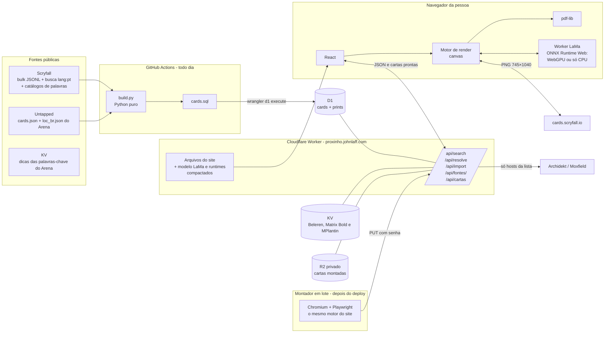

# Arquitetura

O Proxinho tem quatro partes: um **pipeline de dados** que roda uma vez por dia, uma **API** pequena no Cloudflare, o **site**, onde cada carta e o PDF são montados, e o **montador em lote**, que roda o mesmo motor de antemão num Chromium e deixa as cartas prontas no servidor (ADR 0022).

## Caminho de uma lista

1. **Colar.** `src/lib/decklist.ts` lê a lista (MTGO, Arena, Moxfield, Archidekt, Liga Magic), entende seções (comandante, deck, sideboard e fichas), coleção, número e foil, e junta linhas repetidas.
2. **Resolver.** `POST /api/resolve` recebe até 250 nomes, casa cada um com o nome em inglês, o da frente de cartas de duas faces ou o nome em português (sem acento e sem maiúsculas) e devolve a carta com o texto PT e até 80 impressões. Fichas ficam por último, salvo nas linhas da seção "Tokens", que as preferem.
   - **Fichas do deck.** Cada carta traz `tokens` (os `oracle_id` das fichas que cria). O site junta as do pedido, busca as que faltam em `POST /api/cards` e as oferece no resumo; a busca também acha fichas e as adiciona pelo `oracle_id`.
3. **Escolher a arte.** `src/app/model.ts` escolhe a impressão inicial: a pedida na lista, senão a mais recente com moldura suportada, em alta, com borda (a arte sem borda só se a pessoa escolher), sem promo. Sem moldura suportada, a imagem oficial em PT (que também vem antes da tradução não oficial, ADR 0025); sem ela, a original em inglês com aviso, pela mesma ordem e com a moldura suportada na frente (sem isso, a carta sem texto em PT ficava com a arte mais nova, muitas vezes um pôster da Secret Lair). A impressão em PT de que o Scryfall não tem a imagem (a carta em inglês com o selo "Localized Image Not Available") não conta como imagem em PT: o pipeline deixa `pt_print` vazio (`real_image`).
4. **Prévia.** `src/app/preview.ts` procura a prévia já montada (a guardada no navegador e, sem ela, a do servidor, ver abaixo) e, sem nenhuma, monta cada carta com a imagem leve do Scryfall (488 × 680), 4 por vez, com cache. Planeswalkers e artes sem borda usam o PNG já na prévia (ver abaixo). Cartas de duas faces ocupam dois espaços na folha: frente e verso. Quando o motor não reconhece a moldura na imagem e devolve a original (raro: o Garruk espelhado da Secret Lair tem os dados de uma moldura comum), a prévia anota a falha (`noteRender`) e as etiquetas e o resumo passam a dizer que a carta sai em inglês.
5. **PDF.** Cada carta é montada de novo com o PNG (745 × 1040, 300 ou 480 dpi) em `src/app/printFaces.ts`: enquanto a pessoa revisa, `warmPrints` já monta as do pedido em segundo plano, uma de cada vez, depois das prévias e só com a página parada (sem nada antes do clique com a economia de dados ligada); no clique, `src/app/exportPdf.ts` usa as prontas e monta o resto, 4 por vez num computador e 2 no celular (ADR 0014). A prévia acabada e a face do PDF ficam guardadas no IndexedDB (`src/app/cardStore.ts`), com a chave pelo resumo do código que desenha, as fontes e a entrada inteira da carta: na visita seguinte a mesma carta aparece sem montar nada. Sem a guardada, a face do PDF também é procurada no servidor. `src/lib/pdf.ts` pagina em 3 × 3, com frente e verso seguidos em cada cópia de carta de duas faces. A sangria tem a cor da borda da carta; nas artes sem borda, é a própria imagem esticada até a beira da célula (`bleedLayers`).

## O motor da carta

`src/engine/render.ts` faz quatro passos num canvas:

1. Baixa a imagem do CDN do Scryfall (CORS liberado, então o canvas pode ser lido).
2. **Apaga** nome, tipo e caixa de texto (`erase.ts`): uma máscara marca os pixels de texto (escuros ou de cor diferente da textura; em faixas escuras, o contrário), cresce um pouco para pegar a borda suavizada e é preenchida de fora para dentro numa pirâmide de resoluções, o que reconstrói a cor da moldura; o grão do papel vem por cima, copiado em remendos de outros pontos da mesma região (`addGrain`), de perto e, no meio de um texto denso, de qualquer ponto dela. Num papel de retícula grossa a pirâmide parte da média dos vizinhos, não do pixel exato (`smoothNoisyPaper`). Caixa de texto escura ou barra de tipo sem os dois fios não é a moldura da M15 e a carta sai na original (`notM15Frame`). Nas cartas com tabela de d20 (AFR, AFC, CLB) as faixas cinza atrás das linhas da tabela saem inteiras (`liftShadedBands`) e são pintadas de novo atrás das linhas da tabela em português (`drawTableBands`). Abaixo da medida fixa da caixa só sai o que se liga às letras de cima, nunca o fio de baixo (`keepAttachedBelow`); o lembrete "3/5" do verso das cartas de transformar é apagado até a moldura, linha a linha (`eraseBackPtNotch`); e nas fichas o fio entre as regras e o flavor sai inteiro (`dividerRows`). Poder/resistência, custo de mana e símbolo da coleção ficam protegidos.
   - Nos **planeswalkers** (`planeswalker.ts`) a moldura (caixa alta ou normal) e as faixas de cada habilidade são medidas na própria imagem (o texto de cada habilidade fica centrado no escudo dela, e a última faixa apaga até o fio de baixo da caixa), e a caixa translúcida é preenchida por uma rede neural de inpainting, o **LaMa** (`lama.ts`), numa worker separada (`lamaWorker.ts`): na placa de vídeo pelo runtime WebGPU do ONNX Runtime Web (`onnxruntime-web/webgpu`) quando há uma de verdade, na CPU pelo runtime só de CPU (`onnxruntime-web/wasm`) quando não, cada um num pedaço de JavaScript à parte e com o `.wasm` compactado em gzip (o runtime JSEP do pacote principal falhava no LaMa, ADR 0013); a sessão fixa o lote em 1 (`sessionOptions`), e o preparo calcula de uma vez as constantes da transformada de Fourier (3 s em vez de 10 s na CPU). A pirâmide deixaria uma mancha borrada sobre a arte; o LaMa continua a textura. A caixa da lealdade inicial vai escondida do modelo, para a cor preta dela não vazar no papel acima (ADR 0011), e os pingos de tinta que o modelo às vezes inventa no papel liso saem depois do preenchimento (`dropSpecks`). Um vigia mede cada etapa da worker (download, preparo, quadro; o limite do quadro segue o ritmo medido): travada ou com erro, ela é trocada pela do degrau seguinte (placa de vídeo, CPU com várias threads, CPU com uma), e sem degrau que funcione o planeswalker volta ao push-pull e a arte sem borda sai na original, com a etiqueta "o apagador de texto não rodou" e o motivo na gaveta. Na prévia (`preview.ts`), essas cartas vão numa fila à parte, uma de cada vez (a da gaveta na frente, `hurry`), e mostram antes o rascunho (`draftUrl`: `renderCard` com `neural: false`, o preenchimento simples onde iria a rede neural, à frente das prévias comuns que esperam; o da carta aberta começa na hora, e a acabada só monta depois dele) com o andamento por quadro e o tempo que falta (`onNeural`, `frameCount`, `neuralLine`, `NeuralStage`); a gaveta diz se a conta roda na placa de vídeo ou no processador, e por quê: a worker conta o motivo de ter ficado na CPU (`GpuProblem`: sem WebGPU, sem adaptador, adaptador simulado ou falha) e a gaveta o escreve (`neuralWhere`). Detalhes nos ADRs 0008, 0013 e 0014.
   - Nas **artes sem borda** (`borderless.ts`) a arte ocupa a carta inteira e nome, tipo e regras ficam em barras e numa caixa translúcidas, escuras, com letra branca, nos lugares da M15. O motor confere a moldura na imagem (o aro dos dois lados da caixa e a barra do nome no alto, `borderlessBox`) e desiste, com a carta na original, quando ela não bate, quando a barra de tipo está mais baixa (a caixa curta da série Drácula de VOW, que o pipeline já deixa de fora), quando a caixa, ou uma parte grande dela, é clara (`lightBorderlessBox`) ou quando a arte atrás tem retícula grossa (`screenNoise`). A máscara marca só as letras brancas (`whiteTextMask`) e o fio entre as regras e o flavor (`boxDividers`), e tudo vai ao LaMa: a caixa num quadro só, reduzida aos 512 px do modelo (ADR 0015; em dois quadros na resolução da imagem a carta levava 30% mais e saía igual), com a cor inventada sem nada parecido em volta devolvida à média da vizinhança (`tameInvented`) e o grão da vizinhança de volta depois (`regrain`, nunca mais forte que o grão fino em volta de cada ponto); as duas barras num quadro só. O selo de promoção fica escondido do modelo (`borderlessStamp`: o que destoa do fundo (acima do aro, também da faixa nas colunas vizinhas, para a arte de dois tons não passar por selo), não é liso e tem par da mesma cor do outro lado do eixo dele, dentro do retângulo de `findCardStamp`, que procura a borda preta e, sem ela, o pé medido da caixa; o aro em volta dele, que pode mudar de cor de um lado para o outro, entra também pela forma: trecho claro e fino, ligado ao selo, com par claro do outro lado do eixo). A caixa de P/R é medida contra a arte das mesmas linhas, com o desenho da moldura de reserva (`borderlessPtBox`): a medida das molduras opacas compara com o papel acima da caixa de texto, que aqui é a arte. Nas cartas com nome de crossover (`flavor_name`, como o Skeletor no Tinybones da Secret Lair) o nome do alto fica como impresso e o nome em PT vai na aba logo abaixo da barra, no lugar do nome de jogo em inglês (`subtitleLetters`, com a aba achada pelo aro de baixo, `subtitleShift`); a aba vai sozinha ao LaMa, também nas artes com borda. Detalhes no ADR 0012.
   - Nas **artes estendidas com a barra de tipo translúcida** (escura, com a arte por trás e letra branca, como no Return of the Wildspeaker de ELD), a máscara das barras opacas pega a arte junto com as letras. Quando ela pega mais de 5% da barra longe das letras brancas (`glassBarLetters`, em `borderless.ts`), só as letras saem, medidas como nas barras da sem borda (`whiteTextMask`), e o preenchimento é a pirâmide, que guarda a arte em volta. Sem a rede neural, então a carta não fica mais lenta.
   - Nas **Sagas** (`saga.ts`) a caixa é uma coluna à esquerda da arte, com uma faixa por capítulo e os marcadores com o número romano numa tira à esquerda, que não é apagada. O pipeline remonta o texto em PT com o número de cada capítulo ("I — …", "I, II — …", `saga_chapters`), porque o Arena traz um parágrafo por capítulo sem o número, e põe no alto o lembrete oficial das Sagas impressas em PT (`top_reminders`, `top_reminder`), que o Arena não tem. O lembrete de palavra-chave de cada capítulo ("Arregimentar Orcs 1. (Coloque um marcador…)") vem das impressões em PT, como nas outras cartas (ver o pipeline). O motor mede na imagem o lado da arte (`sagaArtLeft`), os fios entre as faixas (`sagaDividers`: a sombra e o degrau claro na largura toda, medido em duas linhas por causa das digitalizações), os números dos marcadores (`sagaNumerals`) e a barra de tipo no pé (`typeBarEdges` de 850 a 960). Os marcadores ficam e os fios mudam de lugar: para cada corpo, de 30 a 18, `sagaPlan` põe cada fio entre os marcadores de dois capítulos, com o texto de cada um centrado nos seus marcadores, e fica o maior corpo que cabe. O fio antigo sai na máscara e o novo é desenhado com o fator de cor de um fio da própria carta (`dividerProfile`, `drawDivider`). Sem texto no alto (nenhuma carta impressa com o mesmo lembrete), o fio de cima sai. O apagamento é só das letras, para a marca-d'água de Dominaria ficar inteira, e a curva da tira no pé da faixa do alto fica protegida (`sagaTopFrame`). Sem os números, as faixas ficam como estão; se o número de fios não bate com o de capítulos ou o texto não cabe, a carta sai na original. Detalhes no ADR 0016.
   - Nas **Aventuras** (`adventure.ts`) nome, tipo, símbolo e P/R seguem o caminho da M15, e a caixa é um livro aberto. O motor confere o livro na imagem (`adventureBook`: a lombada escura entre as páginas e a barra do tipo da aventura bem mais escura que o papel) e mede o topo do papel da página da esquerda, a coluna da lombada e o pé das páginas; sem o livro, a carta sai na original. As duas barras da aventura são apagadas como as do nome e do tipo, o nome até antes do custo dela (`adventureCostLeft`), e recebem o nome e o tipo em PT da segunda face (`adventure` em `renderCard`, que `renderInput` manda nas cartas de layout `adventure`). A página da direita faz o papel da caixa (as regras e o flavor da criatura) e a da esquerda recebe as regras da aventura, cada uma com o próprio corpo, até 30. O papel escurece em direção à lombada: cada coluna das páginas é clareada até o tom da mais clara antes de apagar, e depois o que não foi apagado volta exatamente como era e o remendo ganha a sombra da coluna (`pageShade`, `shadePage`), senão a beira do retângulo virava "letra" e o remendo deixava um degrau. Detalhes no ADR 0017.
   - Nas **Classes** (`classCard.ts`) a coluna de texto fica à direita da arte, com o lembrete no alto numa caixa fixa (acima de um fio fino em y ≈ 206) e uma barra por nível (a linha preta com o chanfro, o degradê, o custo e o "Level N"). O pipeline põe no alto o lembrete oficial das Classes impressas em PT (`top_reminder`) e tira o modelo "CLASSLEVEL […]" do Arena e as marcas "//Level_N//" do texto impresso. O motor confere a coluna e o bisel (`classColumn`), o fio do lembrete (`classRule`) e as barras (`classBars`), e acha o maior corpo, até 30, em que todas as habilidades cabem com a folga dividida por igual (`classPlan`, como o Proxyshop). O "Level N" sai de cada barra, as barras são recortadas com o custo (`cutStrip`), a coluna é apagada (as barras antigas inteiras, com o bisel refeito por `restoreBevel`) e elas são coladas no lugar novo (`pasteStrip`), com o "Nível N" na Beleren onde acabava o "Level N". Sem os fios, ou com outro número de barras, a carta sai na original. Detalhes no ADR 0019.
   - Nas **naves e planetas com Posicionar** (`station.ts`, `renderStation`) a caixa translúcida tem, embaixo do texto principal, uma faixa por nível, cada uma mais escura que a de cima, com um selo redondo com o nível à esquerda e, na última, a caixa de P/R, os dois no meio da faixa. O pipeline lê o nível na linha interna "STATIONLEVEL [9+] …" do Arena em inglês e escreve as habilidades de cada nível como o Oracle ("9+ | Voar, iniciativa", `station_level`, `join_station`). O motor acha o pé da caixa (`stationBottom`), os selos pelo anel escuro do miolo (`stationBadges`), as faixas a partir deles (`stationBands`) e a caixa de P/R (`stationPt`), e acha o maior corpo, até 30, com a mesma folga em volta de cada texto (`stationPlan`, como as artes estendidas, que vêm sem a explicação do Posicionar; a última linha que passa por cima do selo da coleção acaba acima do aro dele). Selos e P/R são recortados seguindo o contorno (o disco do selo; o miolo do P/R linha a linha com a folga do anel, `ptShape`, sem o que tem a cor da moldura, `withoutFrame`), a moldura dos lados é refeita na vertical só onde estava o recorte (`restoreFrame`), o escurecimento das faixas sai (`shadeRatio`, `shadeProfile`, `applyShade`), o LaMa apaga as letras (só a tinta preta: a arte escura atrás da caixa fica, `inkOnly`), os selos, o P/R e os limites antigos (com uma faixa de papel acima do selo da coleção à vista dele; a caixa espelhada para os lados, `mirrorSides`, em duas metades na resolução da imagem, `clipMasks`), e as faixas escurecem de novo onde o texto em PT pede, com selos e P/R colados no meio delas. Detalhes no ADR 0020.
   - Nas **fichas** (`token.ts`) a linha de tipo muda de altura conforme o texto: o motor acha a barra pelos dois fios escuros que a emolduram e o pé da caixa pelo fio de baixo. O nome em inglês é apagado só entre a primeira e a última letra (`centralSpan`, que ignora o brilho e o contorno claros das pontas da barra); o português sai centralizado em versalete, e texto de uma linha só, centralizado (ADR 0009). Emblemas usam a mesma moldura; o título é o nome do planeswalker ou a palavra "Emblema", conforme a largura do título impresso, e o texto sai centrado quando o inglês é centrado (ADR 0010). Neles e nas fichas sem P/R o canto da caixa de P/R também é apagado. Na moldura de 2003, a placa escura do nome é achada pela cor de fundo e pelo filete dourado em volta dela, repintada e recebe o nome em dourado (ADRs 0010 e 0011); nas outras, o nome sai em branco ou preto, ou no dourado medido das letras apagadas (ADR 0011).
   - Nas **cartas de duas faces**, o motor desvia dos ícones de transformar, do indicador de cor e do lembrete de P/R do verso (ADR 0007). As **Lições** (STX, TLA, SOS) têm o mesmo círculo à esquerda do nome, e o nome começa depois dele (`hasLeftIcon`; nas de SOS, sem o efeito marcado no Scryfall, o ícone é conferido na imagem por `hasLessonIcon`, ADR 0011).
   - **Medidas na imagem.** A moldura real muda alguns pixels entre coleções e digitalizações, então o motor confere na própria imagem os fios da caixa de texto (`insideBoxSides`), a barra de tipo mais baixa da arte estendida (`typeBarTop`), o topo e o lado da caixa de P/R (`ptBoxTop`, `ptBoxLeft`), o selo de promoção (`findStamp`, com a proteção seguindo a curva da cúpula dele, `stampShape`), onde começa o símbolo da coleção (`findSetSymbolLeft`; linha a linha, quando ele avança na diagonal sobre o tipo, `symbolRowsLeft`; nos versos de duas faces desde 2022, sem símbolo, o tipo vai até o fim da barra), a cor das letras, fatia por fatia (`textPolarity`), e a ponta arredondada das barras, linha a linha (`barCapGuard`), que fica intacta e não semeia a máscara. Nas caixas de letra escura o limiar das letras é medido por ladrilho (`tileNoise`), para a textura de uma caixa translúcida metade sobre a arte não virar "texto". Nas barras o fundo de cada linha é a mediana dela, menos onde as letras passam da metade da linha (aí, a mediana do que está perto do tom da barra), e um trecho denso da máscara abaixo das letras é arte que invade a moldura e fica (`dropArtBelowText`). A medida fixa de `geometry.ts` é o ponto de partida e o limite. A caixa de P/R e o selo ficam e não servem de fonte para o preenchimento, para a cor deles não vazar no papel (ADR 0011).
3. **Amplia** para a resolução de impressão.
4. **Escreve** o português (`text.ts`) com a Beleren (nome e tipo; na moldura de 2003, a Matrix Bold, como na carta impressa) e a MPlantin (texto), servidas em `/api/fontes/` a partir do KV (`fonts.ts`; sem elas, Eczar e Splentinex): quebra em linhas com símbolos de mana em SVG (travessão e número no fim da habilidade nunca começam linha; a continuação de uma opção "•" recua até o texto dela), procura o maior corpo que cabe (de 34 a 15), põe lembretes em itálico e o texto de ambientação só se couber com folga. O texto sai alinhado à esquerda, ou centrado quando o inglês da própria imagem é centrado (alguns feitiços curtos, muitas fichas e emblemas), medido antes de apagar (`measureCentered`).

As medidas da moldura estão em `geometry.ts`, na escala da imagem de 745 × 1040. A moldura de 2003 a 2014 passa pelo mesmo caminho da carta comum, com a caixa um pouco mais estreita e curta, o apagamento das barras começando depois da ponta, que é mais funda, o nome e o tipo na Matrix Bold, no centro das minúsculas medido nas cartas, e começando onde começavam na época da impressão (`frame2003` e `frame2003Start`, ADR 0024); com efeito de moldura, marca-d'água ou planeswalker, ela sai na original.

## Cartas montadas no servidor

O montador em lote (ADR 0022) monta de antemão as cartas que o site montaria: `scripts/montagem/montar.mjs` abre num Chromium a página do montador (`src/montagem/pagina.ts`, num build à parte, `vite.montagem.config.ts`), que chama as mesmas funções do site (`renderInput`, `renderPreview`, `renderPrint`) e calcula a mesma chave das cartas guardadas no navegador (`cardKey`: o SHA-256 do resumo do código que desenha, das fontes, do tipo da imagem e da entrada inteira da carta). O build do montador leva o mesmo resumo que o build do site do mesmo commit (`scripts/codigo.ts`), e o montador só grava se o site no ar é desse código (`codigo` em `/api/health`). Para cada carta com texto oficial (`GET /api/cartas/lista`, das mais jogadas às menos), ele monta a prévia e a face do PDF na qualidade padrão de cada arte suportada: primeiro as artes que passam pela rede neural, depois a arte que o site escolhe sozinho, depois as outras, até o depósito chegar a 6 GB (ADR 0023). Antes, apaga as cartas de códigos velhos. Só monta o que falta no servidor (`POST /api/cartas/<código>/faltando`) e grava em `PUT /api/cartas/<código>/<chave>.jpg`.

Ele roda no GitHub Actions (`.github/workflows/montagem.yml`, ADR 0023), em 12 máquinas padrão que dividem as faces em rodízio, sem senha guardada: o job pede ao GitHub um token OIDC, e o Worker (`worker/github.ts`) confere a assinatura com as chaves públicas do GitHub e as afirmações do token (o repositório e o dono pelos números, a main, o arquivo `montagem.yml` e uma máquina do GitHub). À mão, vale a senha do montador (segredo `CARTAS_TOKEN`).

O Worker (`worker/cartas.ts`) serve `GET /api/cartas/<código>/<chave>.jpg` do R2 (`proxinho-cartas`, privado), pelo cache da borda, com `cache-control: immutable`, `x-robots-tag: noindex` e `x-traduzida` (0 quando a carta saiu na original em inglês, para as etiquetas). O site (`savedCard` e `serverCard` em `src/app/cardStore.ts`) procura a carta no servidor depois da guardada no navegador e antes de montar, uma vez por chave e por visita, até 5 s; com as fontes da pessoa, nem procura.

## Banco (D1)

- `cards`: uma linha por carta (`oracle_id`), com nome em inglês e português, apelidos normalizados para busca (`search_en`, `search_pt`), origem do texto (`arena`, `impresso` ou `nao-oficial`; nas 86 impressões em PT que o Scryfall tem só na imagem, o texto impresso vem de `data/traducao/transcritas.json`, transcrito dela, ADR 0026), faces em JSON, a impressão PT mais recente e `tokens` (JSON com as fichas que a carta cria). As fichas e os emblemas também são linhas de `cards`, com `layout = 'token'` e, nas faces, P/R e cores. Uma face pode ter `ability_words`: as linhas do texto em PT que começam com palavra de habilidade ou de ambientação ("Aterragem — …"), que o motor escreve em itálico, como na carta impressa; a lista dessas palavras vem dos catálogos do Scryfall (`/catalog/ability-words` e `/catalog/flavor-words`), e as palavras-chave com travessão ("Max speed —") ficam de fora. Cada face de uma ficha de duas faces é uma linha de `prints` da ficha equivalente; a de trás tem id `<id>#1` (`printImage` em `src/engine/types.ts`). No texto do Arena, o pipeline põe a explicação das palavras-chave onde o Oracle a traz, com o texto oficial das cartas impressas em PT (`reminder_texts`, `add_reminders`, ADR 0018) e, onde nenhuma impressa a traz, com a dica oficial que o Arena mostra ao lado da carta, quando ela diz o mesmo que o Oracle (`arena_reminders`, `hint_reminder`, a partir de `data/cache/arena_dicas.json`, que o workflow diário baixa do KV; ADR 0021). A carta sem texto oficial em PT ganha a tradução não oficial (`add_unofficial`, ADR 0025), linha a linha do Oracle sem o lembrete e com o nome como "~": a linha oficial igual (o Arena na frente), o molde de uma oficial que só muda nos números e símbolos (com o plural) ou a linha de `data/traducao/linhas.json`, traduzida no padrão do Arena; o tipo vem das oficiais e de `data/traducao/tipos.json`. Depois ela recebe o mesmo acabamento das do Arena (custo de lealdade, lembrete do alto, explicação das palavras-chave e palavras de habilidade em itálico), sem flavor e com o nome em inglês, salvo o impresso em PT. Uma linha sem tradução deixa a carta em inglês.
- `prints`: uma linha por impressão em inglês, com coleção, número, artista, data, moldura, efeitos, a coluna `supported` calculada pelo pipeline, `text_flavor` (o flavor em inglês dela é o mesmo da impressão de onde veio o texto em PT, `text_print`: o flavor em PT vale também para ela), `flavor_pt` (JSON com o flavor em PT de cada face quando a arte não leva o da impressão do texto, mas uma versão do Arena com o mesmo flavor em inglês tem a tradução: a fala da Sra. Margarida na Birds of Paradise da BLC), `flavor_name` (o nome de crossover impresso no alto, quando há), `indicator` (indicador de cor numa carta de uma face só, como Crashing Footfalls) e, nas cartas de duas faces, `sides` (JSON com custo, P/R, indicador e suporte de cada face).
- `meta`: data da última atualização (aparece em `/api/health`, com o `codigo` do build no ar).

## Segurança

- CSP restrita (`public/_headers`): scripts só do próprio site (mais `wasm-unsafe-eval` para o WebAssembly do LaMa), imagens só do Scryfall.
- Isolamento de origem (`Cross-Origin-Opener-Policy: same-origin` e `Cross-Origin-Embedder-Policy: credentialless`), que libera várias threads no WebAssembly.
- Importador com lista fechada de hosts, para o Worker não virar proxy aberto.
- Cartas montadas no servidor: o R2 não tem endereço público; o Worker só entrega uma carta pela chave exata (SHA-256), sem listagem, com `noindex`. Gravar, listar códigos e apagar pedem a senha do montador, comparada sem vazar pelo tempo, ou o token OIDC do workflow da montagem (só o de `montagem.yml`, na main deste repositório, numa máquina do GitHub; ADR 0023).
- Nenhum dado pessoal: sem cadastro, sem cookies; a lista fica só no `localStorage` do navegador.
